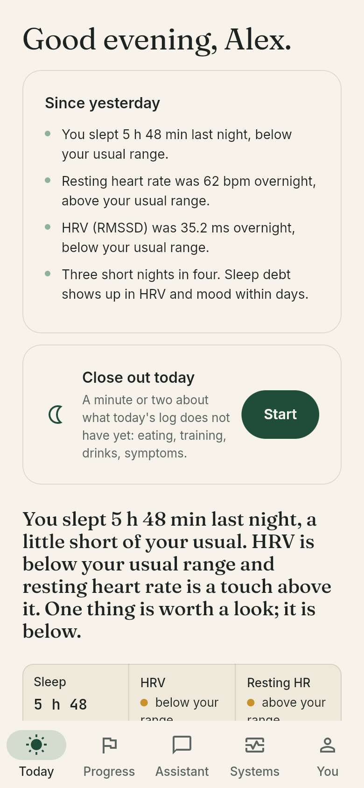
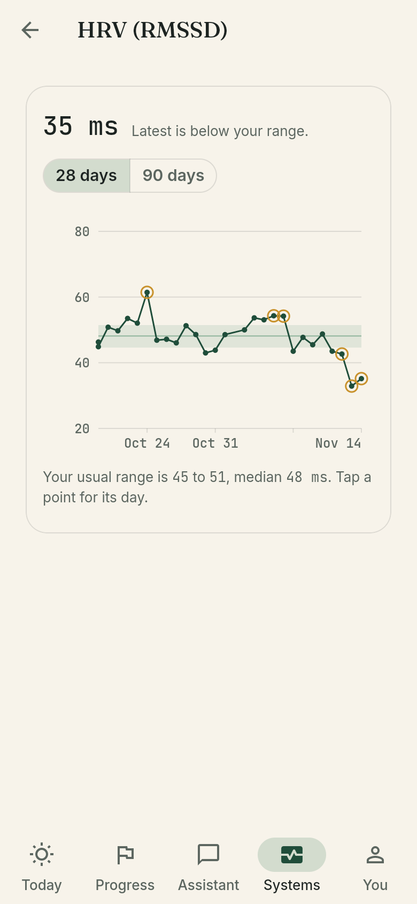
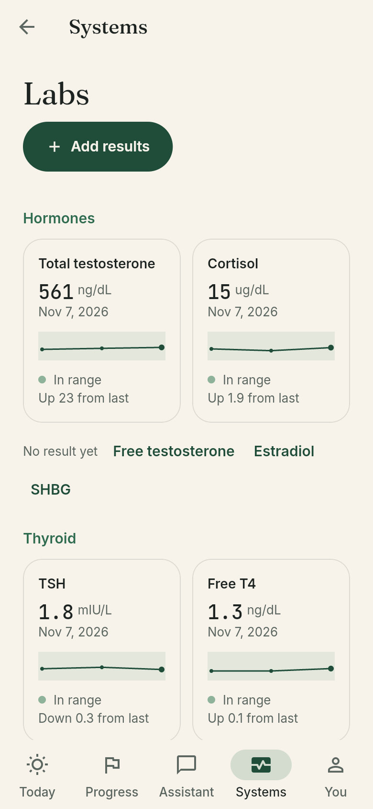
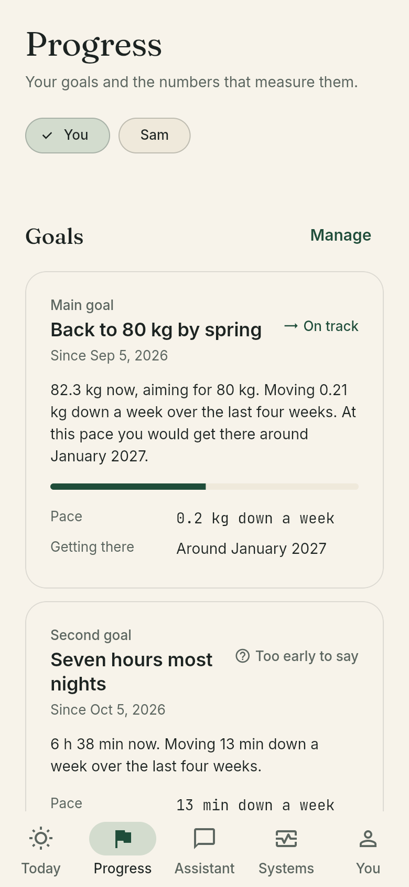
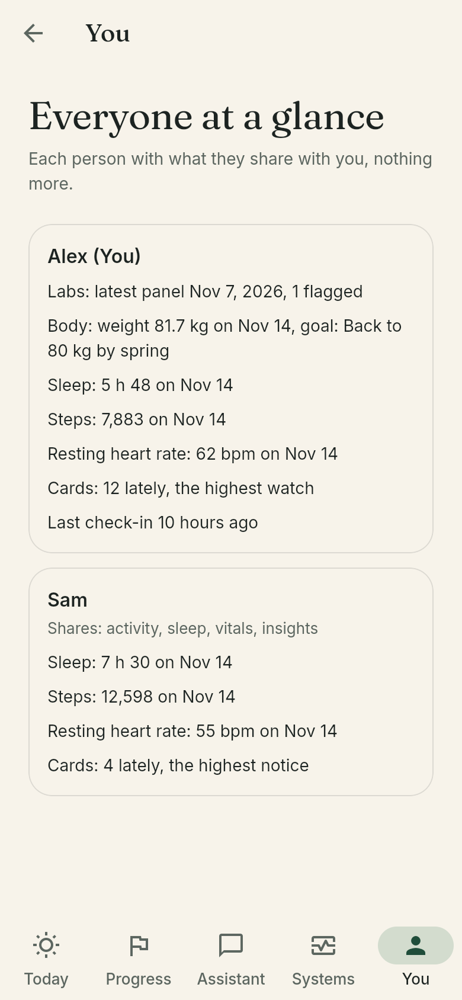
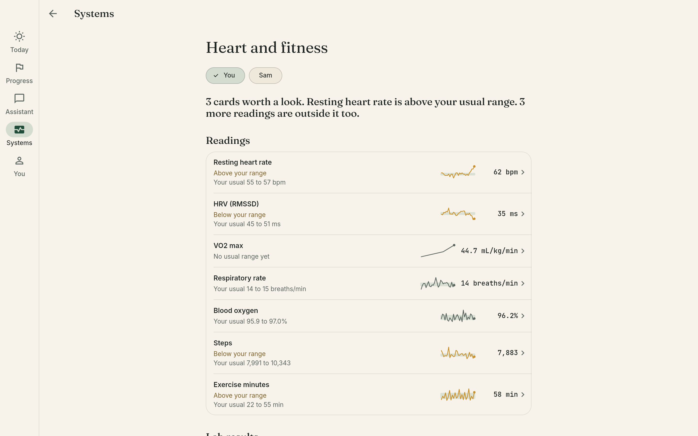

<div align="center">


# SelfKept

**Your health, kept at home.** A self-hosted health record for a whole household: phones,
watches, a ring and blood panels, on a machine you own.

[](https://github.com/jbarnell1/selfkept/actions/workflows/ci.yml)
[](https://github.com/jbarnell1/selfkept/releases/latest)
[](LICENSE)
[](https://github.com/jbarnell1/selfkept/pkgs/container/selfkept)
[](https://github.com/jbarnell1/selfkept/stargazers)
[](https://github.com/jbarnell1/selfkept/commits/main)





<sub>Screenshots show an invented household ("Alex" and "Sam") with generated data.</sub>

</div>

## What it is

SelfKept keeps the health data of everyone in a house in one place you control. The phone app
reads what Apple Health and Health Connect already hold (steps, sleep, heart rate, HRV, weight
and more from watches and scales), the server can pull an Oura ring's data, and you add blood
panels by scanning or typing them in. It then compares each person with their own usual range
and says in plain words what changed, without ever giving a diagnosis.

It is for households that want this without a vendor's cloud account per person: one container
and a PostgreSQL database on a mini PC, NAS or Raspberry Pi, reached over Tailscale from the
phones and the browser. Each person sees their own record and shares with the others only the
categories they choose. Vendor apps (Apple Health, Google Health, Oura) each show one person's
data from one ecosystem and keep it on their servers; SelfKept trades their polish for one
record across devices and people that stays at home.

## Features

- **One record per person, one server per household.** Sharing is per category (activity, sleep,
  vitals, body, labs, cycle, check-ins, insights), granted by the person whose data it is, off
  by default, and checked in the data layer on every query. The admin runs the household and
  does not get to read anyone's data by being admin.
- **Collects what you already measure.** Health Connect through the Android app (so a Pixel
  Watch, or a Fitbit that syncs to Health Connect, comes along), Apple Health through the iOS
  app (written, not yet built; see the status below), Oura through your own Oura API
  application, and typed-in weight, body fat and waist.
- **Today in one sentence.** Fixed rules compare last night and the day with your own 28-day
  baseline and write insight cards in three calm tiers: notice, watch, and worth raising with a
  clinician.
- **Trends and systems against your own usual.** Every metric over 28 or 90 days with your usual
  band, sleep night by night, workouts, and a weekly review.
- **Blood panels.** 42 catalogued markers with reference ranges and their sources, a photo scan
  on the phone (read on the device) or manual entry, a review of each panel against the one
  before it, and a PDF to take to a clinician.
- **Goals and the things that move them.** Goals with a pace, daily and weekly targets, a
  strength log, medicines and supplements, and a day log.
- **Private assistants.** An in-app assistant worded by a model you run (Ollama or any
  OpenAI-compatible server; templates when there is none), and an MCP endpoint at `/mcp` with
  OAuth 2.1 and per-person consent so Open WebUI can answer questions about your data. Every
  tool call is audited.
- **Made for a small box.** amd64 and arm64 images, memory caps that fit a 4 GB Raspberry Pi,
  secrets generated on first run, a database with no published port, a read-only non-root app
  container, and a nightly backup script.
- **Your data stays yours.** A full JSON export of your own data, and a redacted Markdown
  summary for when you choose to show a cloud model something.

<div align="center">


</div>

The same app runs in a desktop browser:



## Quick start

You need Docker with the Compose plugin and about 2 GB of disk. To try it on the machine you are
sitting at:

```bash
mkdir selfkept && cd selfkept
curl -fsSLO https://github.com/jbarnell1/selfkept/releases/latest/download/compose.yaml
docker compose up -d
```

Open <http://127.0.0.1:8080> on that machine and create the first account. It becomes the admin,
and the first screens ask what you use and set up only that.

The app listens on loopback only, on purpose. To use it from phones and other computers, put
Tailscale on the box and run the installer instead. It downloads the same files, sets the
address to the machine's Tailscale name and publishes the app inside your tailnet with Tailscale
Serve. Run it again later to upgrade; it keeps your settings and data.

```bash
curl -fsSL https://github.com/jbarnell1/selfkept/releases/latest/download/install.sh | bash
```

Backups, the phones, upgrades and the Caddy route for homes without Tailscale are in
[docs/self-host.md](docs/self-host.md).

## What leaves your server

By default, nothing. The server makes no outbound connection unless you turn one of the features
below on, and the web app loads no fonts, scripts or images from any other origin. There is no
telemetry, no analytics, no crash reporting to anyone but your own server, and no update check.

Every outbound connection the server can make, all off until you set them up:

| What | When | Where it goes | What is sent |
| --- | --- | --- | --- |
| Oura | The admin enters an Oura API application and a person connects their ring | `cloud.ouraring.com` (sign-in), `api.ouraring.com` | Sign-in and requests for that person's Oura data. Data comes in; no health data is sent out. |
| Home model | You set `SELFKEPT_AI_ENABLED` and a base URL | The address you set, meant to be Ollama on your own hardware | The figures behind an insight or an assistant reply, to be worded. It goes wherever that URL points, so keep it on a machine of yours. |
| Cloud lookup | You set `SELFKEPT_LOOKUP_ENABLED` and your own key, and then each person turns it on for themselves | `api.anthropic.com` | One question at a time, exactly the text the person read on screen and sent with a button. By default names, contact details, dates and exact numbers are taken out; the person can choose to add an "About me" summary. |
| Evening reminder | A person enters their own ntfy topic | The ntfy address they typed | A fixed reminder text. No health values. |
| Single sign-on | You set an OpenID Connect provider | Your provider | The usual sign-in exchange. |
| Assistant sign-in | An MCP client names itself with a metadata URL | That public `https` URL | One request for the client's name and redirect address. No health data. |

Other things to know:

- **Assistants you connect read data.** The `/mcp` endpoint answers the assistant each person
  allowed, and nothing else. Connect a model you run and the data stays in your house. Connect a
  cloud assistant and what it asks for goes to that company.
- **The phone apps talk to your server only.** There is no push service (no Firebase Cloud
  Messaging, no Apple push). Lab photos are read on the phone with Google's ML Kit and are not
  uploaded for recognition. Google documents that the ML Kit SDK itself reports usage metrics to
  Google; this has not been measured or switched off in the Android app yet.
- **Getting the software** reaches GitHub Container Registry and Docker Hub for the images, and
  GitHub for the release files. Tailscale's coordination servers see device keys and addresses,
  not your traffic. The Caddy option asks a certificate authority for a certificate if you give
  it a public name.
- **Exports** go where you send them.

The longer version, with what is stored and where: [docs/privacy.md](docs/privacy.md). The cloud
lookup's consent screens and scrubber: [docs/lookup-design.md](docs/lookup-design.md).

## Configuration

Everything is optional and lives in `.env` next to `compose.yaml`. The ones that matter:

| Setting | Default | What it does |
| --- | --- | --- |
| `SELFKEPT_ORIGIN` | `http://127.0.0.1:8080` | The address people type. Sign-in cookies and links are issued for it. |
| `SELFKEPT_PORT`, `SELFKEPT_BIND` | `8080`, `127.0.0.1` | Where the app listens on the host. Loopback keeps it off your LAN. |
| `SELFKEPT_VERSION` | `latest` | Which release to run. Pin a number to upgrade on purpose. |
| `SELFKEPT_AI_ENABLED`, `SELFKEPT_AI_BASE_URL`, `SELFKEPT_AI_MODEL` | off | A model you run rewrites insight sentences and words the assistant. |
| `SELFKEPT_OURA_CLIENT_ID`, `SELFKEPT_OURA_CLIENT_SECRET` | empty | Turns Oura on (or enter them in the app). |
| `SELFKEPT_SSO_AUTHORITY`, `SELFKEPT_SSO_CLIENT_ID`, `SELFKEPT_SSO_CLIENT_SECRET` | empty | Sign in through Pocket ID, Authelia, Authentik or another OpenID Connect provider. |
| `SELFKEPT_LOOKUP_ENABLED`, `SELFKEPT_LOOKUP_API_KEY` | off | The opt-in cloud lookup described above. |
| `SELFKEPT_RETENTION_MONTHS` | the admin's choice, 12 | Months of heart rate kept reading by reading before it is folded to one row a minute. |

There are no passwords to set: the database password and the app's keys are generated on first
run into a Docker volume. The full list is in [selfhost/.env.example](selfhost/.env.example) and
[docs/self-host.md](docs/self-host.md#settings).

## Documentation

**Use it**

| Doc | What it answers |
| --- | --- |
| [docs/privacy.md](docs/privacy.md) | What is stored, who can see what, what leaves the host, how to delete |
| [docs/connect-an-assistant.md](docs/connect-an-assistant.md) | Connecting Open WebUI or another MCP assistant, and what its tools can read |
| [docs/lab-ranges.md](docs/lab-ranges.md) | The reference ranges behind each lab marker, with sources |

**Self-host it**

| Doc | What it answers |
| --- | --- |
| [docs/self-host.md](docs/self-host.md) | Install, the phones, settings, a local model, Oura, single sign-on, backups, disk use, upgrades, Caddy, troubleshooting |
| [selfhost/README.md](selfhost/README.md) | What each file in the self-host package does, ports and networks, how settings reach the app |
| [SECURITY.md](SECURITY.md) | Reporting a security problem, scope, verifying an image |

**How it is designed**

| Doc | What it answers |
| --- | --- |
| [docs/proposal.md](docs/proposal.md) | The original idea in one page |
| [docs/api-contract.md](docs/api-contract.md) | Every API route, with auth and sharing rules |
| [docs/ingest-contract.md](docs/ingest-contract.md) | How phones send samples, and the metric catalogue |
| [docs/setup-design.md](docs/setup-design.md) | The first-run questions and setup steps |
| [docs/sso-design.md](docs/sso-design.md) | Sign-in through your own OpenID Connect provider |
| [docs/insights-design.md](docs/insights-design.md) | Baselines, rules and how a sentence gets written |
| [docs/context-design.md](docs/context-design.md) | Context events, personal patterns, systems, the weekly review |
| [docs/labs-design.md](docs/labs-design.md) | Scanning, confirming and reviewing blood panels |
| [docs/cross-reference.md](docs/cross-reference.md) | How one panel is read against the last, and which readings bear on each other |
| [docs/body-design.md](docs/body-design.md) | Goals, targets, the day log, medicines, strength and Progress |
| [docs/body-research.md](docs/body-research.md) | The sources behind every guidance figure in the body package |
| [docs/assistant-design.md](docs/assistant-design.md) | The in-app assistant: chat, capture, the guard, check-in, brief, reminders |
| [docs/lookup-design.md](docs/lookup-design.md) | The opt-in cloud lookup: consent, the scrubber, what is sent |
| [docs/connect-design.md](docs/connect-design.md) | The MCP server, OAuth 2.1 and Oura |
| [docs/retention-design.md](docs/retention-design.md) | How old heart rate is folded so the database stays small |

**Work on it**

| Doc | What it answers |
| --- | --- |
| [CONTRIBUTING.md](CONTRIBUTING.md), [docs/contributing.md](docs/contributing.md) | Set-up, branches, the rules CI checks |
| [docs/roadmap.md](docs/roadmap.md) | What is built, how each part was verified, known gaps, what is next |
| [CLAUDE.md](CLAUDE.md), [.claude/rules/](.claude/rules) | The conventions for the backend, the app, tests and the self-host package |

## Project status and roadmap

Pre-release, v0.1.9. It runs one household's data today, so expect rough edges.

- **Works:** the server, the web app, and the Android app on a real phone (a Pixel with Health
  Connect).
- **Not there yet:** there is no signed Android build to download and no store listing, so the
  phone app has to be built from source for now. The iOS app is written but has never been
  compiled. No push notifications.
- **Untried against the real thing:** Oura with a live account, and the cloud lookup with a real
  provider key. Both are covered by tests against fakes.
- **Narrow in places:** the lab scan knows one provider's layout (Rythm); other panels are typed
  in. Lab values use US conventional units (mg/dL and the like).
- "SelfKept" is a working name. It lives in `brand/brand.yaml` and nothing else hard-codes it.

What was verified and how, the known gaps and what comes next:
[docs/roadmap.md](docs/roadmap.md).

## How it was built

Most of this code, its tests and its design docs were written with Claude Code, directed and
checked by one person; the conventions it works to are in the repository (`CLAUDE.md` and
`.claude/rules/`). It is tested rather than trusted: more than 1,100 backend test methods and
more than 800 Flutter tests, and the rules require, for every repository method, a test where a
household member without a grant is refused. CI runs the backend suite against a real
PostgreSQL, a vulnerable package check, `dart format`, `flutter analyze`, the Flutter suite and
a web build on every pull request. Changes are also run as the built image and looked at in a
browser, light and dark, at laptop and phone width (the checklist is in
[docs/roadmap.md](docs/roadmap.md)).

## Develop

You need the .NET 10 SDK, Flutter 3.44 (stable) and Docker.

```bash
scripts/dev-up.sh          # Postgres container, API on :5000, Flutter web on :3000
scripts/smoke.sh           # version and health
scripts/dev-down.sh        # stop it (data kept)
cd backend && dotnet test
cd flutter && flutter test
```

`backend/` is the C# .NET 10 API (PostgreSQL 16 with pgvector, SQL-first migrations) and also
serves the web build. `flutter/` is one Flutter app for iOS, Android and web. `selfhost/` is the
installer, the compose file and the backup script. PowerShell twins of the scripts exist.

## Contributing

Bug reports, ideas and pull requests are welcome. Start with [CONTRIBUTING.md](CONTRIBUTING.md);
the [Code of Conduct](CODE_OF_CONDUCT.md) applies.

## Security

Report security problems privately, not in a public issue: [SECURITY.md](SECURITY.md).

## Licence

AGPL-3.0-only. See [LICENSE](LICENSE). Copyright Jonathan Barnell.
